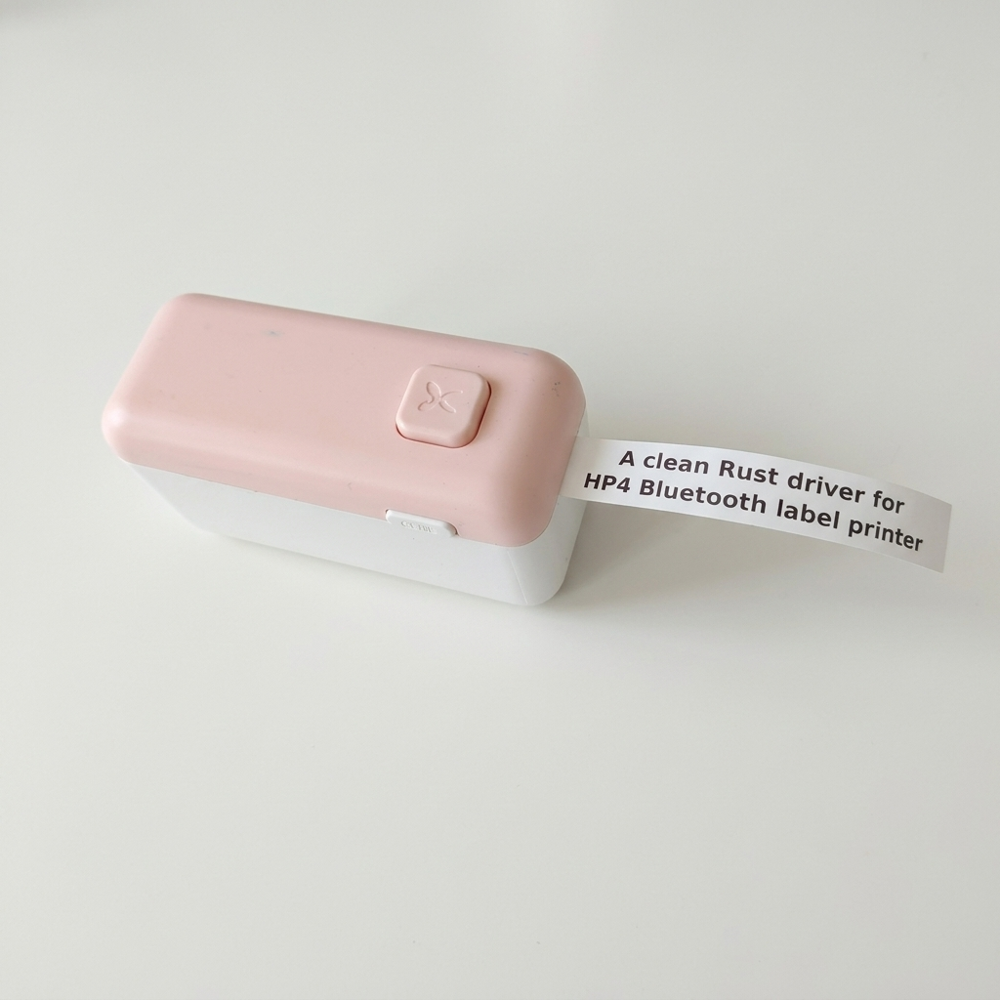

# open-hp4-printer

[](https://github.com/OmoYauhen/open-hp4-printer/actions/workflows/ci.yml)

**A clean Rust driver for the HP4 Bluetooth label printer. No app, no account, no cloud.**



Print text and images on the **HP4** portable Bluetooth label printer (also sold as
DS-702 / KD1 / LP4) from Linux. One static Rust binary: no CUPS, no BlueZ
libraries, no phone app. The protocol was reverse engineered from the vendor's
Android app; see [docs/PROTOCOL.md](docs/PROTOCOL.md).

## Download

Static Linux binaries for x86_64 and aarch64 (Raspberry Pi etc.) are attached to every
[release](https://github.com/OmoYauhen/open-hp4-printer/releases):

```bash
curl -L https://github.com/OmoYauhen/open-hp4-printer/releases/latest/download/hp4-v0.1.0-x86_64-unknown-linux-musl.tar.gz | tar xz
```

## Build

```bash
git clone https://github.com/OmoYauhen/open-hp4-printer
cd open-hp4-printer
cargo build --release        # -> target/release/hp4
cargo test
```

## Setup

```bash
hp4 scan                             # finds HP4 / DS-702 / KD1 / LP4 nearby
hp4 pair-save AA:BB:CC:DD:EE:FF      # no pairing or PIN needed
hp4 status
```

The address can also come from `--addr` or `HP4_ADDR`.

## Use

```bash
hp4 text "Buy Bitcoin"                       # 15 mm continuous tape (default)
hp4 text 'Box 12\nCables' --media 12x40      # die-cut label, two lines
hp4 text "A" "B" "C"                         # three labels in one job
echo "from stdin" | hp4 text
hp4 image logo.png --density dark            # left to right = along the tape
hp4 text "Test" --dry-run --preview p.png    # render only, no Bluetooth
hp4 media                                    # list media presets
hp4 feed 10                                  # feed 10 mm
hp4 auto-off never                           # never|10m|30m|1h|3h|5h|10h|120m
```

Print options:

* `--media <preset>`: tape or label size (see `hp4 media`), default `tape15`
* `--density light|normal|dark|0..15`: print darkness, default `normal`
* `--copies <n>`: print each label n times
* `--margin <mm>`: blank tape at each end so the text clears the cutter, default 5
* `--length <mm>`: minimum tape length
* `--font <file.ttf>`: use another font instead of the built-in one
* `--size <dots>`: font size, default fills the tape
* `--preview <file.png>`: save a picture of what will be printed
* `-o, --output <job.bin>`: write the raw printer bytes instead of printing
* `--dry-run`: build the job without connecting
* `--force`: print even if the printer reports a problem
* `--wait <seconds>`: how long to wait for printing to finish, default 15

Every command that talks to the printer prints JSON (serial, firmware, battery,
flags like `paper_out` / `cover_open`), so an agent can read the result.
Printing refuses to start if the printer reports a problem, unless `--force`.

## Notes

* Anyone in Bluetooth range can print while the printer is on: it has no
  authentication. It accepts one connection at a time.
* With `auto-off never` the printer stays on until switched off; keep it on USB power.
* The built-in font is DejaVu Sans Bold (`assets/`, licence in `assets/DejaVu-LICENSE`).
* `tests/fixtures/` holds reference jobs from the encoder version verified on a real
  HP4; `cargo test` checks the encoder still produces them byte for byte.

## Licence

MIT, see [LICENSE](LICENSE). The bundled DejaVu font keeps its own licence
(`assets/DejaVu-LICENSE`).
